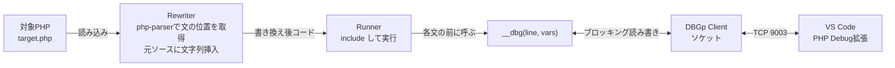

# ちいさくXdebugをつくってみる — PHPMatsuri Reboot ハッカソン計画

## ゴール

- PHPだけで書いた「ちいさいデバッガ」に、**VS Code（PHP Debug拡張）をアタッチしてステップ実行できる**ところまで持っていく
- 実装を通じて Xdebug / DBGp の内部構造を理解する
- デモのオチ：「Xdebugはエンジン側、こちらはソース側で同じことをやる」

## 本物のXdebugとの対比

| 本物のXdebug | ちいさい版 |
|---|---|
| Zendエンジンの実行フック（C拡張） | ソース書き換えで各文の前にフックを挿入 |
| 文の実行前に行番号を照合 | フック関数内で `[file, line]` を照合 |
| ローカル変数はエンジンから直接参照 | 挿入したフックに `get_defined_vars()` を渡す |
| コールスタックはエンジンが保持 | 関数の入口・出口で自前のスタックを積む |
| DBGp（XML over TCP）でIDEと会話 | 同じ。PHPのソケットで最小サブセットを実装 |

## 全体構成



接続の向きに注意：**IDE側が9003でlistenし、デバッグ対象（自作側）が接続しに行く**（本物のXdebugと同じ逆接続）。

## 設計上のポイント

1. **行番号を保つ**
   - php-parserのpretty printerは行番号を保たない
   - → `getStartFilePos()` で文の開始位置を取り、**元ソースの文字列にその位置で挿入**する（改行を足さない）
   - 挿入例：`__dbg(12, get_defined_vars());`
2. **フックはブロックする**
   - `__dbg` 内でIDEからのコマンドを待ち、`run` / `step_*` が来たら戻る
   - ブレークポイント照合・ステップ状態（into/over/out）はフック内で管理
3. **ローカル変数**
   - 呼び出し時の `get_defined_vars()` スナップショットを保持して `context_get` に返す
   - フレームごとに最後のスナップショットを持っておけば、上位フレームの変数もほぼ正確に返せる（呼び出し元は呼び出しの途中で止まっているため。ずれるのは参照渡しや、書き換えられたオブジェクトくらい）
4. **コールスタック**
   - 関数・メソッドの本体先頭に `__dbg_enter(name, line)`、`try/finally` で `__dbg_leave()` を挿入し、自前のフレームスタックを持つ

## DBGp 最小サブセット（IDEが送るもの）

IDE→自作側は `コマンド -i 取引ID 引数\0`、自作側→IDEは `長さ\0XML\0` の形式。

| コマンド | 役割 |
|---|---|
| `feature_set` | IDEの設定通知。とりあえず `OK` を返す |
| `breakpoint_set` | ブレークポイント登録（`-t line -f file -n line`） |
| `run` | 次のブレークポイントまで実行 |
| `step_into` / `step_over` / `step_out` | ステップ実行 |
| `stack_get` | コールスタック |
| `context_names` / `context_get` | 変数スコープ一覧・ローカル変数 |
| `property_get` | 配列・オブジェクトの展開 |
| `status` / `stop` / `detach` | 状態確認・終了 |

接続直後に自作側から送る `<init ... fileuri="file:///..." language="PHP" protocol_version="1.0" idekey="...">` が最初の一歩。

※ XMLの属性やレスポンス形式の細部は、**DBGp仕様書とvscode-php-debugのソース**で事前に確認すること。

## VS Code 側の設定（`.vscode/launch.json`）

```json
{
  "version": "0.2.0",
  "configurations": [
    {
      "name": "Listen for MiniXdebug",
      "type": "php",
      "request": "launch",
      "port": 9003
    }
  ]
}
```

- 拡張機能：「PHP Debug」（xdebug.php-debug）
- 起動順：VS Codeで「Listen」開始 → `php minidbg.php target.php`

## 当日の進め方（段階ごとに動くものが残る）

| 段階 | 内容 | 目安 |
|---|---|---|
| 1 | Rewriter：文の位置に `__dbg()` を挿入、行番号を表示するだけ | 30分 |
| 2 | stdin REPL：`step` / `next` / `continue` / `print $x` | 1時間 |
| 3 | 関数のenter/leaveとコールスタック、`step_into` と `step_over` の差 | 1時間 |
| 4 | DBGp：ソケット接続、`init`、`step_into`、`stack_get`、`context_get` | 1〜2時間 |
| 5 | VS Codeで止まる・変数が見える・ステップできる | 仕上げ |

段階2までで「発表できる最低ライン」、段階4〜5が「見せ場」。

## 事前準備（今週中）

- [ ] `composer require nikic/php-parser` で最小の挿入スクリプトを試す（位置指定の挿入で行番号が保たれることの確認）
- [ ] VS Codeに「PHP Debug」拡張を入れ、9003でlistenできることを確認
- [ ] 簡単なDBGpの `init` パケットをncやPHPで送り、VS Code側が反応するか試す（最大の不確実性）
- [ ] デモ用の対象スクリプトを用意（再帰のフィボナッチ、例外を投げる関数など）

## 意味不明枠のオプション（時間が余ったら）

- 実行中の各ステップを音にする：ループは同じフレーズ、再帰は上昇音階、例外は不協和音
- 変数の値を実況するだけの「実況デバッガ」
- ステップ数に応じて怒り出す（「まだ続けるんですか」）

## 実装時の落とし穴（プロトタイプで確認済み）

1. **`{}` なしの制御構文は意味が変わる**
   - `if ($x) echo "A";` に挿入すると `if ($x) __dbg(...);echo "A";` になり、`echo` が条件に関係なく実行される（構文エラーにならないので気づきにくい）
   - → `{}` のない本体は挿入しない、または `{` と `}` で包む（`else if`、`for`、`while`、`foreach` も同様）
2. **`$this` は `get_defined_vars()` に含まれない**
   - メソッド内では `isset($this) ? $this : null` を別の引数で渡す（`context_get` で見せたい場合）
3. **上位フレームの変数は実はほぼ正確に取れる**
   - フレームごとに「最後の `__dbg` で受け取ったスナップショット」を持てばよい。呼び出し元は呼び出しの途中で止まっているので値は変わっていない
   - ずれるのは参照渡しや、オブジェクトを書き換えたときくらい
4. **ループの条件の行は1回しか止まらない**
   - `foreach` / `while` の文の前に1回挿入されるだけなので、本物のXdebugのように繰り返すたびにループの行では止まらない（デモでは気にならない程度）
5. **クロージャ／アロー関数**
   - `Closure` には本体の `__dbg` は入るが、enter/leave は入らないのでコールスタックがずれる
   - アロー関数は文がないので何も入らない
6. **Runner の変数が混ざる**
   - `include` をそのまま書くと Runner 側のローカル変数が `get_defined_vars()` に混ざる
   - → `(static function () { include func_get_arg(0); })($tmp);` のように引数で渡して include する
7. **`stack_get` の filename は元ファイルのパス**
   - 実行するのは書き換えた一時ファイルだが、行番号が同じなので、IDE には元ファイルの `file://` URI を返せばよい
8. **挿入は後ろの位置から順に**
   - 前の位置から挿入すると、それより後ろの位置がずれる → 位置で `krsort` してから `substr_replace`

## リスクと割り切り

- 書き換え方式なので、`eval`、`include` した別ファイル、`static` クロージャの内側などは追従が甘い → **対象は単一ファイルのスクリプト限定**にする
- 上位フレームの変数はフレームごとのスナップショットで返す（参照渡しや、書き換えられたオブジェクトはずれることがある）
- Xdebug本体のような条件付きブレークポイント、watchなどは対象外
